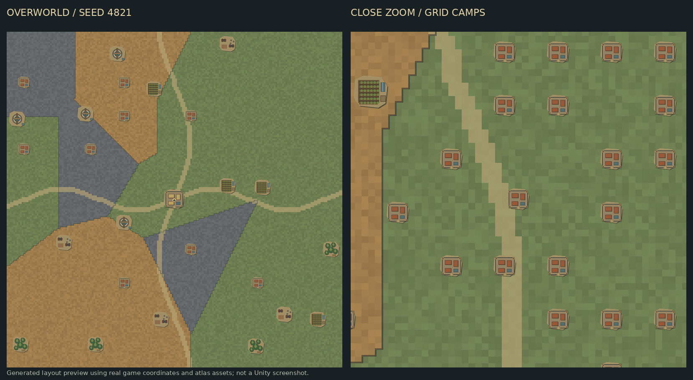

# Flat grid overworld and raid travel view

## Presentation and coordinates

The world map is now a top-down 2D strategy view. A **201 × 201** invisible integer grid spans X/Y −100 through +100 (the existing saved Z coordinate is shown as Y). Settlement, resource and camp markers share the same tile-centre transform as the terrain. The settlement interior retains its 3D isometric view.

One generated 804 × 804 terrain texture represents all 40,401 tiles; tiles do not create individual GameObjects. Original flat farm, well, scrapyard, woodland, camp and settlement symbols share one 768 × 512 atlas. The art generator is `Tools/Art/build_overworld_tiles.py`. Convoys retain the existing miniature bus/bike images and actual mission movement.

Three Voronoi threat zones are anchored by home and the original nine camps:

- Level 1: dry grassland, muted green.
- Level 2: rust badlands, dusty ochre.
- Level 3: ash wastes, charcoal grey.

Zone boundaries and decorative dirt tracks are visible. The compact map header shows the region, threat level and X/Y coordinates under the viewport centre. Selected resources and camps show their coordinates in their existing compact controls/report. Decorative terrain is not a pathfinding obstacle.

There are **256 deterministic enemy camps**, each matching its zone's difficulty. The original nine retain their IDs, exact coordinates and encounter templates. Additional camps use the remaining grid cells, avoid resource sites and home, and keep an eight-unit separation. They use the three existing local PvE encounters; they are not network players or clans.

At overview zoom, only the original nine principal camp markers appear. Zooming closer reveals nearby additional camps. Offscreen camps are disabled, and all camp images share the atlas. This reduces visual clutter and UI work; it is not a device performance benchmark.

Newly generated resource deposits contain **1,000 / 2,000 / 3,000** units according to zone level. Resource types, worker carrying capacity, gathering speed and automatic return rules remain unchanged.

## Launched raid

Camp actions remain RAID and SCOUT. RAID still opens hero selection, followed by LAUNCH RAID. A successful launch now clears the selected camp, closes the hero and camp panels, hides the bottom map controls and expands the terrain viewport. The convoy continues moving on the map. **CONTROLS** restores the normal controls; selecting another camp/site also restores them. Failed dispatch does not switch into travel view.

HOME selection and zoom entry into the settlement continue to work. No scene reload, new combat system, PvP or networking is introduced.

## Save compatibility

Save schema remains nine because no persisted fields changed. Existing sites keep exact coordinates, remaining deposits, workers and cargo. Updating does not refill old sites. Save validation accepts their older 1,000-unit balances while checking the new regional maximum and army cargo conservation. Original camps, scouting and active mission targets remain valid. Reset/new maps receive the richer regional deposits.

## Verification

**691 gameplay checks pass**, including 100 seeded camp-layout builds, original camp compatibility, camp spacing and zone levels, regional deposits, unchanged legacy stock/workers, cargo bounds and grid conversion. Syntax, asset references and PNG properties also pass. Unity API compilation and Android performance/input checks remain local.

Run **Ashlands → Validation → World Map → Map and Raid Selection** once outside Play. This combines native map and raid-preparation checks: shared atlas/tiled terrain, camp counts/culling, actual hero selection and launched-raid control hiding. Normal play only needs Open Settlement Scene → Play.

This preview uses the actual seed-4821 grid, camp/site coordinates and atlas images. It is a generated layout preview, not a Unity screenshot; it shows overview marker filtering on the left and close-zoom camps on the right.

## Missing PNG import recovery

The project also bundles `Resources/Map/OverworldAtlasPixels.bytes`: the exact same atlas as bottom-up RGBA pixels. If Unity cannot load the PNG texture, MapLandmarkArt creates and shares one cached texture from this TextAsset. It uses Texture2D.LoadRawTextureData, so no image-conversion package is required. The shared backup texture is released when the last map view is destroyed, including temporary validator views. No gameplay/save data is changed and no art is downloaded at runtime. The native overworld validator explicitly decodes the raw backup as well as checking the visible UI.
